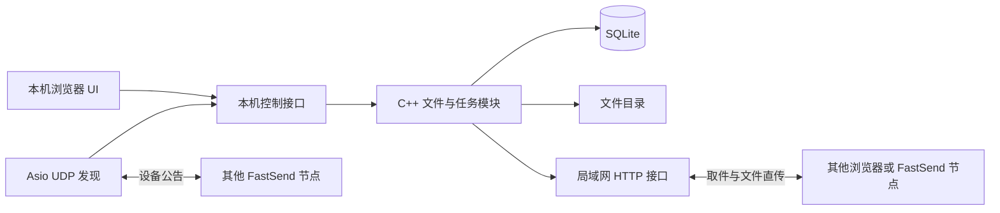

# FastSend · V-1

基于 C++ 的轻量级局域网文件传输项目，用于软件工程设计实战课设。

**V-1 目标：先搭起服务，完成简单网页 UI，并支持“取件码下载”和“设备之间直接发送”两种方式。** 后续继续完善 Linux 部署与使用体验。

> 当前处于规划阶段。本次仅添加 README，尚未实现服务、UI 或传输功能；下文的接口、目录、指标和工时均为开发计划。

## 1. 版本范围

| 项目 | V-1 约定 |
| --- | --- |
| 服务与传输模块 | C++17 |
| UI | 浏览器网页，HTML / CSS / 少量原生 JavaScript |
| 网络环境 | 同一可信局域网，设备可以相互访问 |
| 传输方式 A | 上传到 FastSend 节点，生成取件码和链接，接收方用浏览器下载 |
| 传输方式 B | 自动发现附近 FastSend 节点，选择设备发送，对方确认后直接传输 |
| 文件范围 | 单次一个文件，建议首版限制为 100 MiB |
| 并发范围 | 每个节点同时处理一个文件传输任务；网页查询仍需正常响应 |
| 持久化 | 文件保存在本机目录，元数据和传输记录保存在 SQLite |
| Linux | 从开始保留可移植性，完整部署、打包和后台服务管理放到后续版本 |

这里的“类似 LocalSend”指**局域网发现设备、选择设备、对方确认、设备间直传**这一使用方式。FastSend 使用自己的简化协议。

V-1 暂不包含：账号系统、云存储、公网中转、跨网穿透、原生桌面窗口、手机原生客户端、文件夹传输、批量发送、断点续传和自动更新。手机可以先通过浏览器取件。

## 2. 两种传输方式

### A. 网页取件

1. 发送方运行 FastSend，在本机网页选择并上传文件。
2. 本机服务保存文件，生成取件码与包含本机局域网地址的下载链接。
3. 接收方打开链接，或访问发送方节点的取件页面并输入取件码。
4. 页面显示文件名、大小和有效期，接收方点击下载。

接收方只需要浏览器。取件码只在生成它的节点内有效，因此分享时必须同时提供节点地址；只发一个取件码无法定位设备。服务运行期间才能下载，首版建议有效期为 24 小时。

### B. 局域网直传

1. 两台电脑分别运行 FastSend，并打开各自的本机网页。
2. 节点通过 UDP 广播发现其他 FastSend 节点，网页显示在线设备。
3. 发送方选择设备和文件，本机服务先暂存文件，再发送文件名、大小等传输请求。
4. 接收方网页显示待接收请求，由接收方确认或拒绝。
5. 确认后，两端 C++ 节点通过 HTTP/TCP 传送文件，接收端写入指定接收目录。
6. 双方显示成功、拒绝、超时或失败状态；成功后清理发送端临时文件。

这里的直传指两端节点直接通信，无须中心服务器。文件由 C++ 节点接收并落盘；网页负责选择文件、展示设备和确认操作。自动发现受网络环境影响，首版同时保留“手动输入目标 IP 和端口”。

## 3. 技术方案

| 部分 | 建议方案 | 用途 |
| --- | --- | --- |
| 工程构建 | CMake | 管理 C++ 工程与依赖 |
| HTTP 服务及客户端 | cpp-httplib | 托管页面、上传下载、节点之间传输 |
| UDP 发现 | standalone Asio | 局域网广播、接收设备公告 |
| 数据交换 | nlohmann/json | 请求、响应与设备信息 |
| 数据库 | SQLite C API | 文件信息、分享记录、传输结果 |
| 页面交互 | 原生 HTML / CSS / JavaScript | 减少前端工程配置；轮询任务状态 |

同一个可执行程序同时承担服务端和发送端角色。网页分享与直传共用文件保存、大小检查、状态记录和错误处理逻辑。

[cpp-httplib](https://github.com/yhirose/cpp-httplib) 提供 HTTP 服务与客户端能力；[Asio](https://think-async.com/Asio/) 提供跨平台网络能力；[SQLite](https://www.sqlite.org/whentouse.html) 适合本地嵌入式数据存储。开发时固定依赖版本，并分别验证 Windows 与 Linux，不能把“选用了跨平台库”当作已经完成跨平台测试。

### 节点结构



建议区分本机控制接口与局域网接口：选择本机文件、接受请求等操作仅由本机管理页面发起；局域网接口处理取件和经过授权的传输。管理接口只绑定回环地址，并校验管理令牌和请求来源，防止其他设备直接批准接收。

首版使用可信局域网内的 HTTP。设备名和发现公告不代表身份认证；HTTPS、设备配对与更完整的身份校验列入后续计划。

## 4. UI 需要做什么

用一个简单网页提供三个区域即可，优先让流程清楚。

| 区域 | 最少内容 |
| --- | --- |
| 网页分享 | 选择单个文件、上传按钮、处理状态、取件码、下载链接、复制链接 |
| 网页取件 | 输入取件码、文件名与大小、有效期、下载按钮、错误提示 |
| 附近设备与任务 | 本机名称和地址、设备列表、刷新、手动填写地址、发送按钮、接收确认、任务状态 |

接收端打开本机网页后，轮询待接收请求与状态即可，首版无须 WebSocket。对远程浏览器只展示取件页面。第一阶段先显示“等待确认 / 传输中 / 完成 / 失败”；精确百分比进度可在主流程稳定后补充。

## 5. 需要实现的模块

| 模块 | V-1 工作内容 | 验收方式 |
| --- | --- | --- |
| 服务骨架 | 配置监听地址和端口、托管页面、健康检查、日志 | 程序启动后页面可访问，健康接口返回正常 |
| 文件处理 | 上传、下载、临时文件、接收目录、大小限制 | 同名文件不覆盖；下载内容与原文件一致 |
| 网页分享 | 生成不重复随机取件码、查找文件、过期判断 | 正确码可下载，错误码和过期码有提示 |
| 设备发现 | 广播节点 ID、设备名、端口和协议版本；去重、忽略自己、设备超时移除 | 两台电脑能相互发现，离线设备能移出列表 |
| 设备直传 | 请求接收、等待确认、授权令牌、传输、落盘、结果查询 | 对方批准后才传输；拒绝和超时不保存完整文件 |
| 数据记录 | 文件、分享与传输记录；重启后恢复有效分享 | 重启后分享可查；中断任务标记失败 |
| 异常处理 | 网络断开、文件缺失、写入失败、端口占用、服务繁忙 | 显示明确原因，清理不完整文件，允许重新发送 |

文件按随机 ID 存储，原始文件名只用作显示和下载名称，不能直接拼接成任意磁盘路径。传输使用分块读写，避免把整个文件载入内存；上传失败时回收临时文件。过期分享禁止下载，并提供手动清理入口。

直传授权令牌需要绑定任务、文件大小和有效期，完成或失败后失效。发现公告中不包含本地文件路径；手动地址只允许合法局域网目标，设置连接与读写超时。

### 拟定的数据实体

| 实体 | 主要字段 |
| --- | --- |
| FileRecord | id、原始名称、存储路径、字节数、创建时间、文件状态 |
| Share | id、file_id、唯一取件码、过期时间、下载次数 |
| TransferTask | id、可空 file_id、方向、对端地址、声明文件名与大小、任务状态、错误信息、起止时间 |

FileRecord 与 Share、TransferTask 通过 file_id 关联。接收请求尚未收到文件时，TransferTask.file_id 为空；成功落盘后再关联文件。附近设备先保存在内存中，避免为课设额外增加设备管理系统。

直传任务状态建议为：待确认 → 传输中 → 成功；另有拒绝、超时、失败等结束状态。已结束的授权不能再次上传，程序重启后未完成任务按失败处理，V-1 重新发送整个文件。

### 拟定的接口分组

| 接口 | 所在范围 | 用途 |
| --- | --- | --- |
| GET /health | 本机 / 局域网 | 检查节点服务是否正常 |
| GET / | 本机 | 管理 UI |
| POST /api/shares | 本机 | 上传文件并创建分享 |
| GET /s 与 /api/shares/{code} | 局域网 | 取件页面与分享信息 |
| GET /api/shares/{code}/download | 局域网 | 下载有效分享 |
| GET /api/devices | 本机 | 查询发现的设备 |
| POST /api/send 与 GET /api/tasks/{id} | 本机 | 发起直传并查询进度 |
| GET /api/inbox 与 POST /api/inbox/{id}/decision | 本机 | 展示接收请求、同意或拒绝 |
| /api/peer/info、/api/peer/requests、/api/peer/tasks/{id}、/api/peer/upload | 局域网 | 手动连接、申请传输、查询授权结果、凭令牌上传 |

接口路径属于草案，正式开发时确定 HTTP 方法、参数、响应和错误码。先定义请求与响应，再对接页面。

## 6. 开发顺序与预计时间

估算前提：以 1 名主要开发者计算，有 C++ 基础；两台可互访的电脑可用于联调；使用上述现成库，不自行编写 HTTP 框架。时间为有效工时，不是连续等待时长。

| 顺序 | 工作 | 预计工时 | 完成标志 |
| --- | --- | ---: | --- |
| 1 | 明确需求、UI 草图、模块和接口设计 | 3–4 小时 | 两种流程、范围和验收标准明确 |
| 2 | C++ / CMake 服务骨架、依赖、页面托管与健康接口 | 4–6 小时 | 能启动服务并打开页面 |
| 3 | 文件上传下载、取件码和有效期 | 8–12 小时 | 通过浏览器完成一次分享 |
| 4 | 三个 UI 区域与状态交互 | 6–8 小时 | 主要操作可在网页完成 |
| 5 | 手动地址直传、接收确认与任务状态 | 8–12 小时 | 两台电脑直接传输成功 |
| 6 | UDP 自动发现、去重与离线处理 | 4–6 小时 | 网页能选择附近设备 |
| 7 | SQLite 持久化、临时文件与异常处理 | 6–8 小时 | 重启、拒绝、失败和清理逻辑可验证 |
| 8 | 双设备联调、关键测试与问题修复 | 6–8 小时 | 两种方式均通过测试 |
| 9 | 课设图表、测试记录、汇报与演示准备 | 8–10 小时 | 课件要求的材料齐全 |
| 10 | 环境、依赖、网络和演示问题缓冲 | 8–12 小时 | 留出调整时间 |
| **合计** | **完整 V-1 与课设材料** | **61–86 小时** | **可演示、可说明、可提交** |

对应节奏：每天有效投入 3 小时，约 21–29 天；每天 6 小时，约 11–15 天。若首次接触 C++ 网络库、构建依赖和网页开发，建议额外增加 30%–50%。Linux 正式部署、安装包和跨平台完整回归不计入该估算。

前端与传输接口会交替联调，表格表示推进顺序，不要求每一行完全结束后才能开始下一行。多人分工可以并行，但工时不能直接按人数相除。

### 里程碑

- **M0：服务可启动，累计约 7–10 小时。** 完成需求收敛、构建、健康检查和最简网页。这是下一步首先要做的内容。
- **M1：网页分享可演示，累计约 21–30 小时。** 上传、取件码、下载主流程跑通；设备相关 UI 可先使用占位状态。
- **M2：两种方式均能工作，累计约 45–64 小时。** 完成直接发送、发现设备、持久化、异常处理和联调。
- **M3：课设可交付，累计约 61–86 小时。** 补齐设计图、实际测试结果、分工说明和演示材料，包含缓冲时间。

时间不足时，优先简化样式、进度展示与历史记录界面。完整 V-1 仍包含自动发现和设备直传；仅完成 M1 时应标记为阶段成果。

## 7. 课设材料清单

依据提供的《作业：软件实战》课件整理。以下是项目交付清单，尚未完成的内容不视为已有成果。

| 课设要求 | FastSend 需要准备的内容 |
| --- | --- |
| 5–6 人分组、项目与分工介绍 | 成员名单、负责内容、项目背景、两种使用场景；题目与其他组是否重复需另行确认 |
| 可行性分析 | 技术：C++ 网络库与局域网通信；操作：浏览器交互；经济：现有电脑与局域网资源；数据流图 |
| 需求分析 | 功能与非功能需求、实体联系图（E-R 图）、分享和传输任务状态图 |
| 总体设计 | 软件层次图、模块职责、节点通信方式、数据库表与关系 |
| 详细设计 | 网页分享与直传的程序流程图、关键流程盒图（N-S 图）、接口说明 |
| 测试方案 | 关键功能黑盒测试；记录测试数据、测试用例、预期结果、实际结果 |
| 汇报 | 项目介绍、设计说明、演示步骤、结果与后续计划 |

课件指定汇报在第 12 周周二及周五，实际日历日期需结合课程安排确认，本计划不自行推算截止日期。

### 建议分工

| 角色 | 主要内容 |
| --- | --- |
| 需求与统筹 | 范围、进度、可行性、汇报整合 |
| 服务与网页分享 | 服务骨架、上传下载、取件码 |
| 局域网传输 | 设备发现、请求与确认、直传 |
| 网页 UI | 页面、接口联调、状态与错误提示 |
| 数据与测试 | 数据库、测试用例、实际结果、演示验证 |
| 第 6 位成员（如有） | 设计图、文档与演示材料，可协助测试 |

具体姓名和责任人由实际小组确定。

## 8. V-1 验收与测试

| 用例 | 输入或操作 | 预期结果 |
| --- | --- | --- |
| 网页分享成功 | 上传普通文件，另一台设备通过链接取件 | 文件名、大小正确，下载前后文件哈希一致 |
| 错误与过期取件码 | 输入不存在的码；构造过期分享 | 明确提示不可取件，不返回文件 |
| 设备发现 | 同一局域网启动两端，随后关闭其中一端 | 能发现对方、不会显示自己，离线项超时移除 |
| 手动连接 | 自动发现不可用时填写目标地址 | HTTP 可达时仍可发起直传 |
| 同意接收 | 发出请求，在接收端本机网页同意 | 仅授权后接收，落盘内容与原文件哈希一致 |
| 拒绝与等待超时 | 拒绝请求；保持不操作直到超时 | 状态正确，不产生完整接收文件 |
| 文件边界 | 中文名、含路径字符的文件名、同名文件、超过上限 | 中文正常；路径不能越界；不覆盖旧文件；超限拒绝 |
| 网络与磁盘异常 | 传输中断网；模拟不可写目录或空间不足 | 明确失败，清理半成品，任务可重新发起 |
| 授权检查 | 未同意直接上传；复用已结束令牌；远程调用批准接口 | 请求被拒绝，不能绕过接收确认 |
| 重启与忙碌状态 | 有效分享后重启；传输中发起第二个任务 | 分享仍可查；未完成任务标记失败；新任务提示忙碌 |

实际结果和通过状态必须在实现后实测填写。目前没有已执行的测试结果。

演示建议控制在 3–5 分钟：启动服务和页面 → 网页分享与取件 → 自动发现另一台设备 → 请求、接收确认、直传成功 → 展示一次拒绝或错误情况。提前在演示网络确认 TCP/UDP 可达；发现失败时使用手动地址，网络隔离时改用可互访的测试网络。

## 9. 建议的后续目录

以下是代码开发时的目标结构，本次不创建这些文件：

```text
FastSend/
├── README.md
├── CMakeLists.txt
├── src/
│   ├── main.cpp
│   ├── http/          # 页面与 API
│   ├── discovery/     # UDP 设备发现
│   ├── transfer/      # 请求、确认与文件传输
│   └── storage/       # 文件与 SQLite
├── include/
├── web/              # HTML / CSS / JavaScript
├── tests/
└── docs/             # 课设图表、设计说明与测试记录
```

运行时的数据库、分享文件、接收文件和临时文件应放在单独的数据目录，并在开始开发时加入忽略规则，避免上传到 GitHub。当前没有可执行程序，也没有可用的启动命令。

## 10. 后续完善方向

1. **V-2：Linux 使用与部署。** Linux 实机回归、启动脚本、systemd 后台运行、配置和日志、发布包。
2. **V-3：传输体验。** 精确进度、批量文件、目录传输、断点续传、历史记录与清理。
3. **后续按需要增加：** HTTPS、设备配对、完整性自动校验、桌面托盘或原生 UI、更多平台支持。

课设阶段按 V-1 范围推进，后续版本的范围与时间另行评估。

## 参考资料

- [cpp-httplib 官方仓库](https://github.com/yhirose/cpp-httplib)
- [Asio 官方文档与平台支持](https://think-async.com/Asio/)
- [nlohmann/json 官方仓库](https://github.com/nlohmann/json)
- [SQLite 适用场景](https://www.sqlite.org/whentouse.html)
- [LocalSend 协议说明](https://github.com/localsend/protocol)：参考设备发现和接收确认的流程设计。
